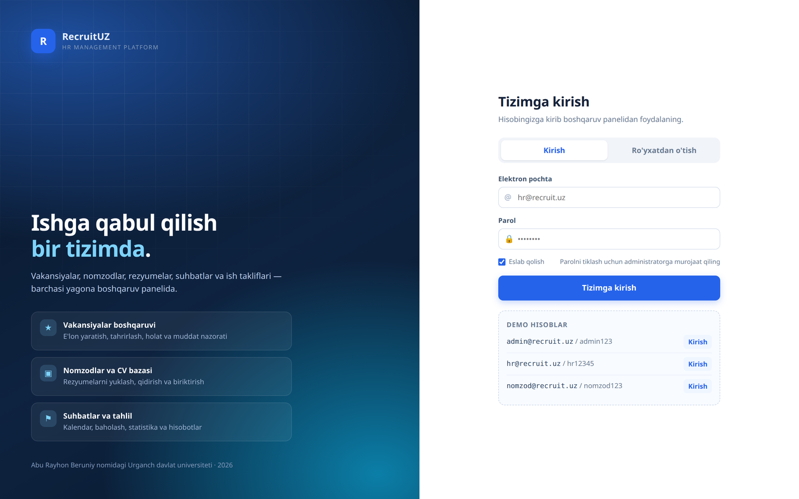
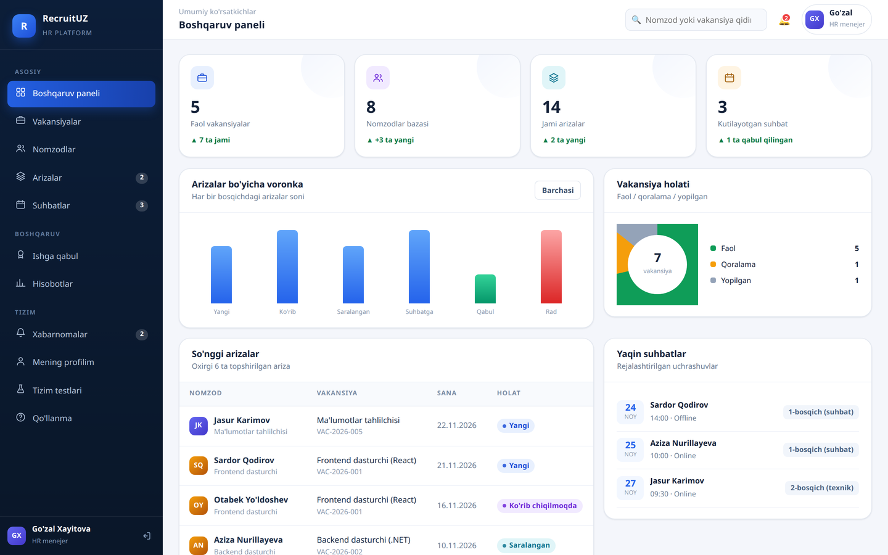
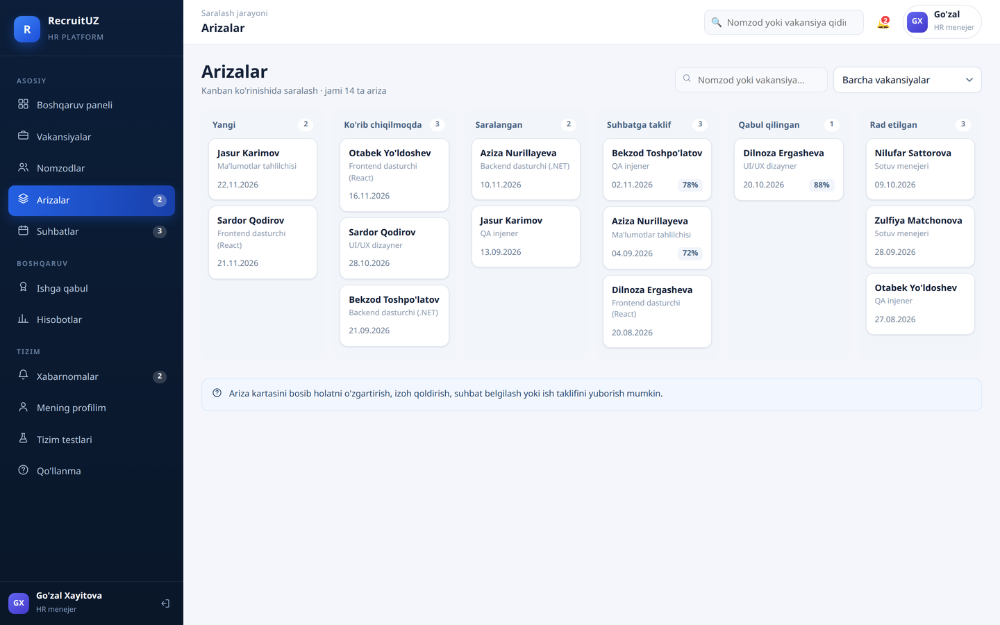
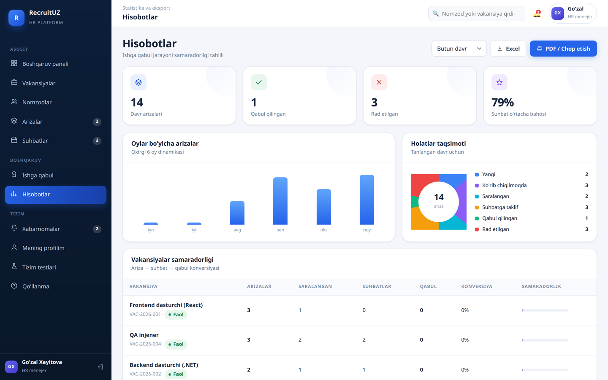
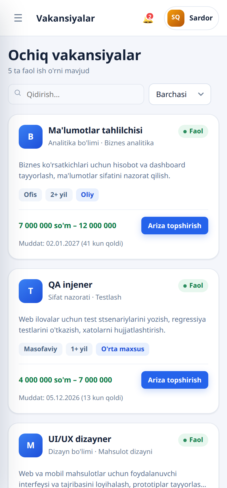

# RecruitUZ — Ishga qabul qilish (Recruitment) tizimi

**23-mavzu** · Abu Rayhon Beruniy nomidagi Urganch davlat universiteti · Kompyuter injiniring fakulteti · KIDT yo‘nalishi · Masofaviy 236-guruh

[](https://github.com/gozal236/Ishga-qabul/actions/workflows/ci.yml)
[](https://gozal236.github.io/Ishga-qabul/)
[](LICENSE)

**Demo:** [gozal236.github.io/Ishga-qabul](https://gozal236.github.io/Ishga-qabul/)

Vakansiyalar, nomzodlar, CV fayllari, arizalar, suhbatlar va ish takliflarini yagona joyda boshqaruvchi web tizim. Ilova bitta `index.html` faylidan iborat: tashqi CDN, kutubxona yoki server talab qilinmaydi — barcha ma’lumotlar brauzerning `localStorage` xotirasida saqlanadi.

---

## Imkoniyatlar

| Modul | Asosiy funksiyalar |
|---|---|
| **Autentifikatsiya** | Ro‘yxatdan o‘tish, kirish/chiqish, parolni xeshlash, 3 rol, profilni tahrirlash |
| **Vakansiyalar** | Yaratish, tahrirlash, o‘chirish, holat (Faol/Qoralama/Yopilgan), qidiruv va filtr, ariza muddati |
| **Nomzodlar va CV** | Profil, ko‘nikmalar, ta’lim, tajriba, PDF/DOC/DOCX yuklash, brauzer ichida ko‘rish, qidiruv |
| **Arizalar** | Onlayn ariza, CV biriktirish, 6 holatli kanban, HR izohi, to‘liq tarix, takroriy ariza nazorati |
| **Suhbatlar** | Jadval va kalendar ko‘rinishi, online/offline, mas’ul xodim, natija, 0–100 baho, bekor qilish |
| **Ishga qabul** | Ish taklifi, qabul sanasi, ish boshlash sanasi, taklif holati, qabul qilinganlar ro‘yxati |
| **Hisobotlar** | Voronka, oylik dinamika, holatlar taqsimoti, vakansiya samaradorligi, Excel va PDF eksport |
| **Xavfsizlik** | Rolga asoslangan ruxsat, SHA-256 parol xeshi, XSS ekranlash, fayl turi va hajmi nazorati |
| **Sozlamalar** | Tizim nomi, CV hajmi chegarasi, standart muddat, JSON zaxira nusxa, xatoliklar jurnali |

## Demo hisoblar

| Rol | Login | Parol |
|---|---|---|
| Administrator | `admin@recruit.uz` | `admin123` |
| HR menejer | `hr@recruit.uz` | `hr12345` |
| Nomzod | `nomzod@recruit.uz` | `nomzod123` |

> Demo ma’lumotlar 7 ta vakansiya, 8 ta nomzod, 14 ta ariza, 6 ta suhbat va 2 ta ish taklifini o‘z ichiga oladi. Har bir nomzod uchun namuna CV (PDF) avtomatik shakllantirilgan.

## Skrinshotlar

| Tizimga kirish | HR boshqaruv paneli |
|---|---|
|  |  |

| Arizalar kanbani | Hisobotlar |
|---|---|
|  |  |

<p align="center"></p>

## Texnologiyalar

- **Frontend:** HTML5, CSS3 (custom design system), JavaScript (ES2020, modul bo‘lmagan yagona fayl)
- **Ma’lumotlar:** `localStorage` (JSON hujjat modeli), `FileReader` (CV fayllari)
- **Xavfsizlik:** Web Crypto API (`SHA-256`), rolga asoslangan kirish
- **CI/CD:** GitHub Actions (sintaksis, tuzilma, tashqi bog‘liqlik tekshiruvi, Pages deploy)
- **Joylashtirish:** GitHub Pages (demo), Nginx (ishlab chiqarish varianti)

## Loyihani ishga tushirish

```bash
git clone https://github.com/gozal236/Ishga-qabul.git
cd Ishga-qabul
# 1-usul: faylni brauzerda ochish
xdg-open index.html

# 2-usul: lokal server
python3 -m http.server 8080
# http://localhost:8080
```

Hech qanday `npm install` yoki build bosqichi talab qilinmaydi.

## Repozitoriya tuzilmasi

```
Ishga-qabul/
├── index.html                    # butun ilova (HTML + CSS + JS)
├── .github/workflows/ci.yml      # CI pipeline va Pages deploy
├── scripts/extract-js.js         # JS blokini ajratib sintaksis tekshirish
├── hujjatlar/                    # 7 ta laboratoriya ishi (Word .docx)
├── docs/
│   ├── arxitektura.md            # modullar va ma’lumotlar modeli
│   ├── texnik-topshiriq.md       # topshiriq matni
│   └── screenshots/
├── README.md
└── LICENSE
```

## Laboratoriya ishlari (Loyihalarni boshqarish fani)

Har bir hujjat laboratoriya mavzusini va texnik topshiriqning tegishli bosqichini birga qamrab oladi.

| № | Mavzu | Texnik topshiriq bosqichi | Hujjat |
|---|---|---|---|
| L1 | Loyiha xartiyasini tuzish. GitHub repozitoriyasini yaratish va sozlash | 1-bosqich: loyiha asosi, autentifikatsiya, rollar | [Word](hujjatlar/01-loyiha-xartiyasi.docx) |
| L2 | User story yozish va baholash. Planning Poker | 2-bosqich: vakansiyalar moduli | [Word](hujjatlar/02-user-story-planning-poker.docx) |
| L3 | Jira’da sprint va backlog. Git branch va Pull Request | 3-bosqich: nomzodlar va CV boshqaruvi | [Word](hujjatlar/03-jira-sprint-git-pr.docx) |
| L4 | Gantt diagrammasi. Risk registri | 4-bosqich: arizalar va saralash | [Word](hujjatlar/04-gantt-risk-registri.docx) |
| L5 | Code Review. GitHub Actions bilan CI | 5-bosqich: suhbatlar moduli | [Word](hujjatlar/05-code-review-ci.docx) |
| L6 | Sprint retrospektivi. Burndown chart tahlili | 6-bosqich: ishga qabul va hisobotlar | [Word](hujjatlar/06-retrospektiv-burndown.docx) |
| L7 | COCOMO baholash. MLOps rejasi. Yakuniy himoya | 7-bosqich: integratsiya, testlash, deployment | [Word](hujjatlar/07-cocomo-mlops-himoya.docx) |

## Loyihaning 7 bosqichi

1. **Loyiha asosi va foydalanuvchilar** — ro‘yxatdan o‘tish, kirish, rollar, profil
2. **Vakansiyalar** — CRUD, holat, muddat, qidiruv, ochiq e’lonlar
3. **Nomzodlar va CV** — profil, ko‘nikmalar, fayl yuklash, qidiruv
4. **Arizalar** — topshirish, saralash, 6 holat, tarix, izohlar
5. **Suhbatlar** — kalendar, online/offline, natija, baho
6. **Ishga qabul va hisobotlar** — taklif, statistika, eksport
7. **Integratsiya va testlash** — 15 avtotest, responsivlik, deployment

Ilova ichidagi **«Tizim testlari»** bo‘limi 15 ta tekshiruvni real ma’lumotlar ustida bajaradi.

## Muallif

**Xayitova Go‘zal Rajabovna** — Masofaviy 236-guruh, KIDT yo‘nalishi
Ilmiy rahbar: **Xusainov Shixnazar**

## Litsenziya

MIT — [LICENSE](LICENSE)
